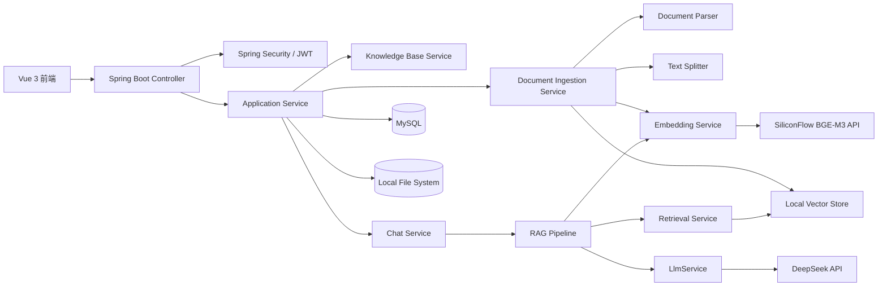
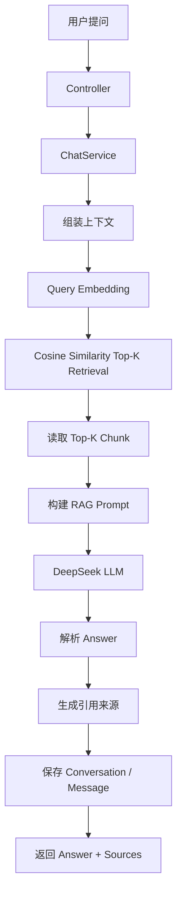
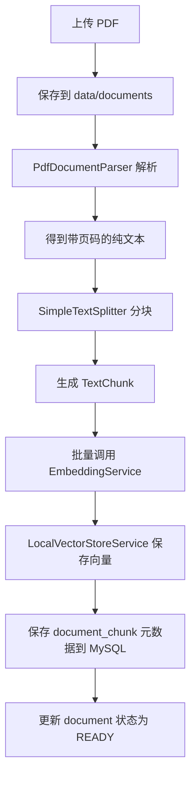
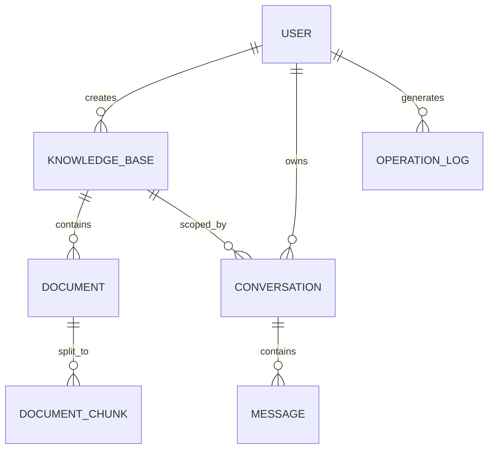

# 基于 Spring Boot + RAG 的企业智能知识库问答系统 · v0.3 Lite 架构设计

> 版本：v0.3 Lite  
> 定位：轻量但可真正运行、可解释、可面试的个人项目  
> 本阶段：只做架构设计，不生成业务代码

## 1. 项目定位

### 1.1 项目名称

基于 Spring Boot + RAG 的企业智能知识库问答系统

### 1.2 项目目标

实现一个真正可以运行的知识库问答系统，而不是堆叠中间件。项目重点体现：

1. Java 17 与 Spring Boot 3.x 开发能力。
2. Spring IoC / DI 的实际应用。
3. Spring AOP 的实际应用。
4. RAG 核心流程理解。
5. PDF 文档解析。
6. 文本 Chunk 分块。
7. Embedding 向量化。
8. 向量相似度检索。
9. DeepSeek LLM 问答。
10. 回答引用来源。
11. MySQL 数据持久化。

### 1.3 设计原则

- 先保证一条最小闭环真正跑通，再逐步补充功能。
- 业务层依赖接口，不依赖具体 AI 厂商和具体向量存储实现。
- AOP 只处理横切关注点，RAG Pipeline 保持显式调用。
- 不在 MVP 引入 PostgreSQL、Redis、Docker、Elasticsearch、Agent、Rerank、Hybrid Search 等超出当前规模的能力。

## 2. 技术栈

### 2.1 MVP 技术栈

| 分类 | 技术 |
| --- | --- |
| 语言 | Java 17 |
| 框架 | Spring Boot 3.x |
| AI 框架 | Spring AI |
| 构建工具 | Maven |
| 数据库 | MySQL |
| ORM | Spring Data JPA |
| 数据库迁移 | Flyway |
| 认证 | Spring Security + JWT |
| LLM | DeepSeek API，OpenAI 兼容协议 |
| Embedding | SiliconFlow BGE-M3 API |
| PDF 解析 | Apache PDFBox |
| 向量存储 | 本地文件系统 + JSON 文件 |
| 前端 | Vue 3，简单单页应用 |
| 工具 | Lombok，如确实需要 |

### 2.2 明确不引入的技术

MVP 不引入：

- PostgreSQL、pgvector。
- Redis。
- Docker、Nginx、Kubernetes。
- Elasticsearch、OpenSearch、Kafka、MinIO。
- Reranker、Hybrid Search、RRF。
- RAG Evaluation、Agent、Tool Calling、MCP。
- 多租户、SSO、独立 Worker、微服务拆分。

这些内容只能进入“未来扩展方向”，不能进入 MVP 实现范围。

### 2.3 为什么选择 Spring Data JPA

本项目选择 **Spring Data JPA**，而不是 MyBatis：

- MVP 表结构简单，实体关系清晰，没有大量复杂多表 SQL。
- JPA Repository 可以减少基础 CRUD 代码，使项目重点更聚焦在 RAG、IoC 和 AOP。
- JPA 与 Spring Boot、Flyway、Spring Data 的集成成本低，适合个人项目快速完成。
- 后续如果出现复杂报表或性能敏感 SQL，可以在需要的地方使用 Native Query 或单独引入 MyBatis，不影响当前分层设计。

## 3. 系统架构图

系统采用“前后端分离 + 单 Maven Module + AI 能力接口抽象”。



### 3.1 请求流向

```text
Vue 3
→ Controller
→ Application Service
→ RAG Pipeline
→ Query Embedding
→ Local Vector Store
→ Cosine Similarity Top-K Retrieval
→ Context 组装
→ Prompt 生成
→ DeepSeek
→ Answer + Sources
→ 返回前端
```

### 3.2 文档处理流向

```text
PDF 上传
→ 文件保存
→ PDF Parser
→ 纯文本
→ Text Splitter
→ Chunk
→ BGE-M3 Embedding
→ Local Vector Store
→ MySQL 元数据持久化
```

## 4. RAG 流程图



### 4.1 RAG 步骤说明

1. 用户输入问题。
2. `ChatService` 根据知识库 ID 和用户上下文发起问答。
3. `EmbeddingService` 将 Query 转成向量。
4. `RetrievalService` 在 `VectorStoreService` 中执行余弦相似度 Top-K 检索。
5. 将 Top-K Chunk 文本作为 Context。
6. 根据 Context、Query 和系统指令构建 Prompt。
7. 调用 DeepSeek 生成答案。
8. 将答案和命中的 Chunk 组装成引用来源。
9. 保存会话和消息。
10. 返回答案、文档名称、页码、Chunk 序号和相关文本片段。

## 5. 文档处理流程图



### 5.1 文档解析要点

- 使用 Apache PDFBox 提取文本。
- 尽量保留页码信息，便于引用来源显示页码。
- 解析结果统一转换为 `ParsedDocument`，避免后续流程依赖 PDFBox 具体类型。

### 5.2 分块要点

- 使用固定大小 + 重叠分块，MVP 阶段足够简单。
- 每个 Chunk 保留 `documentId`、`pageNumber`、`chunkIndex`、`content`。
- 分块结果统一转换为 `TextChunk`，后续可替换为更复杂的分块策略。

## 6. 模块 / 分层设计

### 6.1 单 Maven Module

v0.3 Lite 不再使用多 Maven Module，采用单 Maven Module + 清晰分层 + 领域分包，降低项目复杂度。

### 6.2 分层职责

| 层 | 职责 | 依赖方向 |
| --- | --- | --- |
| `controller` | 接收 HTTP 请求、参数校验、返回统一响应 | 依赖 `service` |
| `service` | 用例编排、事务边界、调用领域与基础设施能力 | 依赖 `domain`、`repository`、接口 |
| `domain` | 领域对象、值对象、业务模型 | 不依赖具体基础设施 |
| `repository` | 数据库访问接口及 JPA 实现 | 依赖 `domain` |
| `infrastructure` | 外部 API 客户端、文件存储、Local Vector Store | 实现抽象接口 |
| `config` | Spring 配置、Bean 注册、Security 配置 | 组装各层 |
| `aspect` | 操作日志、方法耗时等 AOP 切面 | 横切关注点 |
| `security` | JWT Filter、Token Provider、当前用户 | 认证横切 |
| `common` | 统一返回体、异常、错误码、工具类 | 被所有层使用 |

### 6.3 调用规则

```text
Controller
→ Service
→ Repository / Infrastructure
```

- Controller 不直接操作数据库。
- AI 外部 API 调用放到 `infrastructure`。
- 核心业务依赖接口，不直接依赖具体实现。

## 7. 核心接口设计

### 7.1 接口清单

| 接口 | 职责 | MVP 实现 |
| --- | --- | --- |
| `LlmService` | 调用大模型生成回答 | `DeepSeekLlmService` |
| `EmbeddingService` | 将文本转成向量 | `SiliconFlowEmbeddingService` |
| `DocumentParser` | 解析上传文档 | `PdfDocumentParser` |
| `TextSplitter` | 将文本切分为 Chunk | `SimpleTextSplitter` |
| `VectorStoreService` | 保存和检索向量 | `LocalVectorStoreService` |
| `RetrievalService` | 计算相似度并获取 Top-K | `CosineRetrievalService` |

### 7.2 LlmService

职责：屏蔽不同 LLM 厂商差异。

主要方法：

```text
LlmResponse chat(LlmRequest request)
```

`LlmRequest` 至少包含：

- `systemPrompt`
- `userPrompt`
- `model`
- `temperature`
- `maxTokens`

`LlmResponse` 至少包含：

- `content`
- `promptTokens`
- `completionTokens`
- `totalTokens`

MVP 实现 `DeepSeekLlmService`，使用 DeepSeek OpenAI 兼容协议。如果未来换成其他 LLM，只需要新增一个 `LlmService` 实现，不需要修改 RAG Pipeline 核心逻辑。

### 7.3 EmbeddingService

职责：将文本转换为向量。

主要方法：

```text
float[] embed(String text)
List<float[]> embed(List<String> texts)
int dimension()
```

MVP 实现 `SiliconFlowEmbeddingService`，使用 SiliconFlow 提供的 BGE-M3 模型。Embedding 维度通过配置或模型信息获取，不硬编码在数据库和向量文件中。

### 7.4 DocumentParser

职责：将不同格式文档解析为统一文本结构。

主要方法：

```text
ParsedDocument parse(InputStream input, String fileName)
Set<String> supportedExtensions()
```

MVP 实现 `PdfDocumentParser`，使用 Apache PDFBox 解析 PDF，并尽量保留页码。

### 7.5 TextSplitter

职责：将长文本切分为 Chunk。

主要方法：

```text
List<TextChunk> split(ParsedDocument document, SplitConfig config)
```

MVP 实现 `SimpleTextSplitter`，使用固定大小和重叠长度分块。

### 7.6 VectorStoreService

职责：屏蔽具体向量存储实现。

至少包含：

```text
void save(VectorDocument document)
void saveAll(List<VectorDocument> documents)
List<ScoredVectorDocument> search(VectorSearchRequest request)
void deleteByDocumentId(Long documentId)
```

MVP 实现 `LocalVectorStoreService`，将向量保存到 `data/vectors` 下的 JSON 文件。未来替换为 pgvector 或其他向量数据库时，不需要修改上层 RAG 业务逻辑。

### 7.7 RetrievalService

职责：根据 Query Embedding 从候选 Chunk 中检索 Top-K。

主要方法：

```text
List<RetrievedChunk> retrieve(RetrievalRequest request)
```

`RetrievalRequest` 包含：

- `knowledgeBaseId`
- `queryEmbedding`
- `topK`

`RetrievedChunk` 包含：

- `chunkId`
- `documentId`
- `documentName`
- `pageNumber`
- `chunkIndex`
- `content`
- `score`

MVP 实现 `CosineRetrievalService`。

## 8. IoC / DI 设计

### 8.1 目标

本项目重点展示 Spring IoC 和依赖注入，不让业务层直接依赖具体实现。

### 8.2 依赖关系

```text
RagPipeline
├── EmbeddingService
├── RetrievalService
└── LlmService

DocumentIngestionService
├── DocumentParser
├── TextSplitter
├── EmbeddingService
└── VectorStoreService

RetrievalService
└── VectorStoreService
```

### 8.3 Spring Bean 装配方式

- 接口定义在 `service` 或 `domain` 抽象中。
- 具体实现放在 `infrastructure`。
- 使用 `@Service`、`@Component` 标注实现类。
- 使用构造器注入，不在字段上使用 `@Autowired`，便于测试和明确依赖。
- 必要的时候使用 `@Configuration` + `@Bean` 完成外部客户端 Bean 配置。

### 8.4 为什么可以替换 LLM

```text
RAG Pipeline 只依赖 LlmService

LlmService
├── DeepSeekLlmService
└── OtherLlmService
```

如果未来把 DeepSeek 换成其他 LLM，只需要：

1. 新增一个 `LlmService` 实现。
2. 在配置中启用新的 Bean。
3. 保持输入输出领域模型不变。

RAG Pipeline、Retrieval、Embedding、文档解析等核心业务逻辑不需要修改。

### 8.5 为什么可以替换向量存储

`RagPipeline` 和 `RetrievalService` 只依赖 `VectorStoreService` 接口。MVP 使用 `LocalVectorStoreService`，未来接入 pgvector 时只需要新增 `PgVectorStoreService` 实现，不需要修改检索和问答业务。

## 9. AOP 设计

AOP 只处理横切关注点，不承载核心业务逻辑。

### 9.1 OperationLogAspect

自定义注解 `@OperationLog`，用于记录操作日志。

记录信息：

- 当前用户。
- 操作名称。
- 请求时间。
- 类名和方法名。
- 执行结果。
- 异常信息。
- 耗时。

落库到 `operation_log` 表。

### 9.2 ExecutionTimeAspect

自定义注解 `@ExecutionTime`，用于记录方法耗时。

重点统计：

- PDF 文档解析耗时。
- Embedding API 调用耗时。
- 向量检索耗时。
- LLM 调用耗时。

### 9.3 AOP 使用边界

- AOP 只负责日志、耗时、异常记录。
- RAG 核心流程不通过 AOP 隐藏。
- `RagPipeline` 保持显式调用，保证代码可读、可测试、可调试。
- 切面捕获异常后记录并继续抛出，不吞掉异常，不破坏事务语义。

## 10. MySQL ER 设计

### 10.1 核心表

| 表 | 说明 |
| --- | --- |
| `user` | 用户 |
| `knowledge_base` | 知识库 |
| `document` | 文档 |
| `document_chunk` | 文档 Chunk 元数据 |
| `conversation` | 会话 |
| `message` | 消息 |
| `operation_log` | 操作日志 |

### 10.2 ER 关系



### 10.3 表字段设计

#### user

| 字段 | 类型 | 说明 |
| --- | --- | --- |
| id | BIGINT | 主键 |
| username | VARCHAR(64) | 用户名，唯一 |
| password_hash | VARCHAR(255) | 密码哈希 |
| display_name | VARCHAR(64) | 显示名 |
| role | VARCHAR(20) | USER / ADMIN，为后续权限扩展预留 |
| created_at | DATETIME | 创建时间 |
| updated_at | DATETIME | 更新时间 |

#### knowledge_base

| 字段 | 类型 | 说明 |
| --- | --- | --- |
| id | BIGINT | 主键 |
| name | VARCHAR(128) | 知识库名称 |
| description | VARCHAR(512) | 描述 |
| created_by | BIGINT | 创建用户 ID |
| created_at | DATETIME | 创建时间 |
| updated_at | DATETIME | 更新时间 |

#### document

| 字段 | 类型 | 说明 |
| --- | --- | --- |
| id | BIGINT | 主键 |
| knowledge_base_id | BIGINT | 知识库 ID |
| name | VARCHAR(255) | 文档名称 |
| original_file_name | VARCHAR(255) | 原始文件名 |
| file_path | VARCHAR(512) | 本地文件路径 |
| file_type | VARCHAR(32) | PDF / WORD / MD |
| file_size | BIGINT | 文件大小 |
| page_count | INT | 页数，可解析后更新 |
| status | VARCHAR(20) | UPLOADING / PARSING / EMBEDDING / READY / FAILED |
| error_message | VARCHAR(512) | 错误信息 |
| created_by | BIGINT | 上传用户 ID |
| created_at | DATETIME | 创建时间 |
| updated_at | DATETIME | 更新时间 |

#### document_chunk

MVP 只保存 Chunk 元数据，Embedding 数组不写入 MySQL。

| 字段 | 类型 | 说明 |
| --- | --- | --- |
| id | BIGINT | 主键 |
| document_id | BIGINT | 文档 ID |
| chunk_index | INT | Chunk 序号 |
| content | TEXT | Chunk 文本 |
| page_number | INT | 页码 |
| vector_storage_key | VARCHAR(512) | 向量 JSON 文件或记录的引用键 |
| created_at | DATETIME | 创建时间 |

#### conversation

| 字段 | 类型 | 说明 |
| --- | --- | --- |
| id | BIGINT | 主键 |
| user_id | BIGINT | 用户 ID |
| knowledge_base_id | BIGINT | 会话绑定的知识库 ID |
| title | VARCHAR(255) | 会话标题 |
| created_at | DATETIME | 创建时间 |
| updated_at | DATETIME | 更新时间 |

#### message

| 字段 | 类型 | 说明 |
| --- | --- | --- |
| id | BIGINT | 主键 |
| conversation_id | BIGINT | 会话 ID |
| role | VARCHAR(20) | USER / ASSISTANT |
| content | TEXT | 消息内容 |
| sources | TEXT | 引用来源 JSON |
| created_at | DATETIME | 创建时间 |

#### operation_log

| 字段 | 类型 | 说明 |
| --- | --- | --- |
| id | BIGINT | 主键 |
| user_id | BIGINT | 操作人 ID，可空 |
| operation | VARCHAR(128) | 操作名称 |
| method | VARCHAR(255) | 类名.方法名 |
| request_time | DATETIME | 请求时间 |
| duration_ms | BIGINT | 耗时毫秒 |
| success | BOOLEAN | 是否成功 |
| error_message | TEXT | 异常信息 |
| created_at | DATETIME | 创建时间 |

### 10.4 Flyway 迁移

使用 Flyway，在应用启动时自动执行数据库迁移。

至少包含：

```text
V1__init.sql
```

创建：

- `user`
- `knowledge_base`
- `document`
- `document_chunk`
- `conversation`
- `message`
- `operation_log`

## 11. Local Vector Store 设计

### 11.1 设计目标

MVP 不使用 pgvector，使用本地 JSON 文件保存向量，目标是：

- 快速跑通 RAG 闭环。
- 降低部署和运维复杂度。
- 通过 `VectorStoreService` 接口隔离实现，未来可替换为 pgvector。

### 11.2 目录结构

```text
data/
├── documents/
│   └── {documentId}/
│       └── source.pdf
└── vectors/
    └── {knowledgeBaseId}/
        └── {documentId}.json
```

### 11.3 向量 JSON 结构

每个文档一个 JSON 文件，包含文档信息和 Chunk 列表。

每个 Chunk 至少保存：

- `documentId`
- `documentName`
- `pageNumber`
- `chunkIndex`
- `content`
- `embedding`
- `createdAt`

### 11.4 检索流程

1. 将用户 Query 转换为 Embedding。
2. 读取该知识库下的候选 Chunk 文件。
3. 计算每个 Chunk 与 Query Embedding 的 Cosine Similarity。
4. 按相似度降序排列。
5. 获取 Top-K。
6. 将 Top-K Chunk 作为 Context。

### 11.5 异常与边界处理

必须考虑：

- 空向量。
- Embedding 维度不一致。
- 没有候选数据。
- Top-K 超过候选数量。
- JSON 文件缺失或损坏。
- 向量文件读写并发冲突。

建议：

- 保存向量前校验维度。
- 搜索前检查知识库是否为空，返回空列表。
- 实际返回数量为 `min(topK, 候选数量)`。
- 向量文件读写使用文件锁或原子写入，MVP 可先采用同步写入和文件锁。

## 12. API 初步设计

### 12.1 认证接口

| 方法 | 路径 | 说明 |
| --- | --- | --- |
| POST | `/api/v1/auth/register` | 用户注册或初始化管理员 |
| POST | `/api/v1/auth/login` | 登录并返回 JWT |
| GET | `/api/v1/auth/me` | 获取当前用户 |

### 12.2 知识库接口

| 方法 | 路径 | 说明 |
| --- | --- | --- |
| POST | `/api/v1/knowledge-bases` | 创建知识库 |
| GET | `/api/v1/knowledge-bases` | 查询知识库列表 |
| GET | `/api/v1/knowledge-bases/{id}` | 查询知识库详情 |
| DELETE | `/api/v1/knowledge-bases/{id}` | 删除知识库 |

### 12.3 文档接口

| 方法 | 路径 | 说明 |
| --- | --- | --- |
| POST | `/api/v1/knowledge-bases/{kbId}/documents` | 上传 PDF |
| GET | `/api/v1/knowledge-bases/{kbId}/documents` | 查询文档列表 |
| GET | `/api/v1/documents/{id}` | 查询文档详情 |
| DELETE | `/api/v1/documents/{id}` | 删除文档 |

### 12.4 问答与对话接口

| 方法 | 路径 | 说明 |
| --- | --- | --- |
| POST | `/api/v1/knowledge-bases/{kbId}/chat` | 提问并返回 Answer + Sources |
| GET | `/api/v1/conversations` | 查询当前用户会话 |
| GET | `/api/v1/conversations/{id}/messages` | 查询会话消息 |

### 12.5 日志接口

| 方法 | 路径 | 说明 |
| --- | --- | --- |
| GET | `/api/v1/operation-logs` | 查询操作日志 |

### 12.6 统一返回体

```json
{
  "code": 0,
  "message": "success",
  "data": {}
}
```

引用来源至少返回：

- 文档名称。
- 页码。
- Chunk 序号。
- 相关文本片段。

## 13. 项目目录结构

```text
enterprise-rag/
├── pom.xml
├── src/
│   ├── main/
│   │   ├── java/
│   │   │   └── com.example.rag/
│   │   │       ├── RagApplication.java
│   │   │       ├── controller/
│   │   │       ├── service/
│   │   │       ├── domain/
│   │   │       ├── repository/
│   │   │       ├── infrastructure/
│   │   │       │   ├── llm/
│   │   │       │   ├── embedding/
│   │   │       │   ├── parser/
│   │   │       │   ├── splitter/
│   │   │       │   ├── vector/
│   │   │       │   └── storage/
│   │   │       ├── config/
│   │   │       ├── aspect/
│   │   │       ├── security/
│   │   │       └── common/
│   │   └── resources/
│   │       ├── application.yml
│   │       └── db/
│   │           └── migration/
│   └── test/
├── data/
│   ├── documents/
│   └── vectors/
└── README.md
```

### 13.1 关键目录说明

- `controller`：HTTP 入口。
- `service`：业务编排。
- `domain`：实体和值对象。
- `repository`：JPA Repository。
- `infrastructure`：DeepSeek、SiliconFlow、PDFBox、Local Vector Store。
- `config`：Spring 配置。
- `aspect`：AOP 切面。
- `security`：JWT 和 Spring Security。
- `common`：统一响应、异常、工具类。

## 14. MVP 开发阶段

### 14.1 最小可运行闭环

第一优先级是保证以下链路真正跑通：

```text
登录
→ 创建知识库
→ 上传 PDF
→ PDF 解析
→ Chunk
→ Embedding
→ 本地向量存储
→ 用户提问
→ Query Embedding
→ Cosine Similarity
→ Top-K Context
→ DeepSeek
→ Answer + Sources
```

### 14.2 阶段 0：工程脚手架

- Spring Boot 3.x。
- Maven。
- MySQL。
- Flyway。
- Spring Security。
- JWT。
- 统一异常处理。
- 统一返回体。

### 14.3 阶段 1：知识库与文档

- 用户。
- 知识库 CRUD。
- PDF 上传。
- PDF 解析。
- Chunk。

### 14.4 阶段 2：RAG 核心

- Embedding。
- Local Vector Store。
- Cosine Similarity。
- Top-K Retrieval。
- DeepSeek。
- Citation。

### 14.5 阶段 3：对话

- Conversation。
- Message。
- 历史记录。

### 14.6 阶段 4：IoC + AOP 深化

- `LlmService` 接口。
- `EmbeddingService` 接口。
- `DocumentParser` 接口。
- `VectorStoreService` 接口。
- `RetrievalService` 接口。
- `OperationLogAspect`。
- `ExecutionTimeAspect`。

### 14.7 阶段 5：前端

使用简单 Vue 3 前端：

- 登录。
- 知识库。
- 文档。
- AI 问答。
- 引用来源。
- 历史对话。

## 15. 未来扩展方向

以下能力只放在 Future Roadmap，不在 MVP 中提前实现：

- PostgreSQL + pgvector。
- Hybrid Search。
- Rerank。
- Redis。
- Docker。
- Elasticsearch / OpenSearch。
- Agent / Tool Calling。
- RAG Evaluation。
- SSE 流式回答。
- 多租户。
- MinIO / S3 对象存储。
- MCP。

## 16. 为什么 v0.3 Lite 不使用 PostgreSQL、Redis、Docker

### 16.1 为什么不使用 PostgreSQL + pgvector

MVP 数据规模较小，向量数量通常只有几百到几万条。此时使用本地 JSON 文件 + 余弦相似度线性扫描已经足够完成演示和学习。pgvector 的价值主要体现在大规模向量检索和数据库内向量计算，现阶段引入只会增加环境准备、SQL 调优和部署成本。

系统仍然通过 `VectorStoreService` 接口隔离向量存储，未来数据量上升或需要专业向量数据库时，可以直接新增 pgvector 实现。

### 16.2 为什么不使用 Redis

MVP 不存在高并发缓存、分布式锁、分布式会话、限流等硬需求。JWT 登录天然无状态，会话信息可保存在 MySQL 中。Spring 本身可以提供简单的进程内缓存。引入 Redis 会增加一个独立基础设施和运维复杂度，不符合 Lite 定位。

### 16.3 为什么不使用 Docker

Docker 适合团队协作、一致环境和多服务编排。个人项目在本地使用 Spring Boot + MySQL 直接运行更容易理解和调试，也便于面试时解释启动流程。Docker 可以作为后续部署方式，而不是 MVP 必需条件。

## 17. 面试时可以重点讲解的技术点

### 17.1 Spring IoC / DI

讲解如何通过接口隔离 LLM、Embedding、文档解析和向量存储，展示：

```text
LlmService
├── DeepSeekLlmService
└── OtherLlmService
```

说明：更换 LLM 只需要新增实现和切换 Bean，不需要改 RAG 业务代码。

### 17.2 Spring AOP

讲解 `@OperationLog` 和 `@ExecutionTime` 两个真实切面：

- 为什么操作日志和耗时统计属于横切关注点。
- 如何记录文档解析、Embedding、检索、LLM 调用耗时。
- 为什么 RAG Pipeline 不使用 AOP 隐藏核心流程。

### 17.3 RAG 核心流程

可以按顺序讲清楚：

1. 文档上传与 PDF 解析。
2. 文本分块。
3. Embedding。
4. 向量存储。
5. Query Embedding。
6. Cosine Similarity。
7. Top-K 检索。
8. Context 组装。
9. Prompt。
10. LLM 生成。
11. 引用来源。

### 17.4 Local Vector Store 的设计与局限

- 为什么 MVP 使用 JSON 文件而不是 pgvector。
- 如何设计 `VectorStoreService` 接口。
- 如何处理空向量、维度不一致、候选为空、Top-K 越界。
- 数据量变大后如何替换为 pgvector。

### 17.5 数据一致性

讲解：

- MySQL 保存业务元数据。
- 本地 JSON 保存 Embedding。
- 文档解析、Chunk 落库和向量保存之间如何通过状态机保证可恢复。
- 为什么 MVP 不需要跨库最终一致性。

### 17.6 安全设计

讲解：

- JWT 认证。
- Spring Security Filter。
- 密码哈希。
- API Key 和数据库密码通过环境变量管理，不硬编码。

