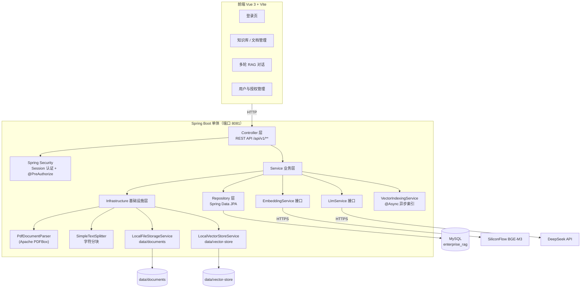

# 系统架构说明

> 本文档基于当前代码实际实现整理，图中组件与实际代码一一对应。

## 1. 总体架构



## 2. 关键组件

| 组件 | 实际实现 | 说明 |
| --- | --- | --- |
| Web 层 | `controller/` 下 8 个 Controller | 暴露 REST API，统一返回 `ApiResponse<T>` |
| 认证 | Spring Security + `HttpSession` | 登录后写 `SecurityContext` 到 Session；**非 JWT** |
| 权限 | `PermissionService` + `@PreAuthorize("hasRole('ADMIN')")` | 接口级权限校验 + 知识库访问/编辑权限 |
| 业务层 | `service/` 下多个 Service | 知识库、文档、检索、问答、会话、用户 |
| 数据访问 | Spring Data JPA `repository/` | 7 个 Repository 接口 |
| PDF 解析 | `PdfDocumentParser`（Apache PDFBox 3.0.4） | 按页提取文本 |
| 文本分块 | `SimpleTextSplitter` | 按字符分块，`chunk-size=1000`、`overlap=200` |
| 文件存储 | `LocalFileStorageService` | 保存到 `data/documents/`（UUID 文件名） |
| Embedding | `HttpEmbeddingService`（`RestClient`） | 调用 SiliconFlow `BAAI/bge-m3`，OpenAI 兼容协议 |
| LLM | `DeepSeekLlmService`（`RestClient`） | 调用 DeepSeek `deepseek-chat`，OpenAI 兼容协议 |
| 向量存储 | `LocalVectorStoreService` | 每个知识库一个 `data/vector-store/{kbId}.json`，余弦相似度 |
| 异步索引 | `VectorIndexingService` + `AsyncConfig` | 事务提交后异步执行，线程池 `vector-index-*` |

## 3. 分层结构

```text
Controller（参数校验、协议转换）
    ↓
Service（业务编排、权限校验、@Transactional）
    ↓
Repository（数据访问）/ Infrastructure（外部能力适配）
```

- **Controller 不写业务逻辑**，只做请求/响应转换与校验。
- **Service** 通过接口依赖 `EmbeddingService`、`LlmService`、`VectorStoreService`、`FileStorageService`，替换实现不修改业务代码。
- **Infrastructure** 承担 PDF 解析、分块、文件存储、向量存储、外部 API 调用等可替换能力。

## 4. 数据存储划分

| 存储 | 职责 | 备注 |
| --- | --- | --- |
| MySQL | 用户、知识库、文档、Chunk、会话、消息、授权关系 | 7 张表，Flyway V1~V8 |
| 本地文件 | 上传的 PDF | `data/documents/`，不入库 |
| 本地 JSON | 向量索引 | `data/vector-store/{kbId}.json`，与 MySQL 中的 Chunk 通过 `chunkId` 关联 |

## 5. 数据表

| 表 | 说明 |
| --- | --- |
| `sys_user` | 用户（含 role、status） |
| `knowledge_base` | 知识库（含 visibility 公有/私有） |
| `document` | 文档（文件路径、状态、页码、错误信息） |
| `document_chunk` | 文档分块 |
| `conversation` | 多轮会话 |
| `chat_message` | 会话消息（user/assistant） |
| `user_knowledge_base` | 用户-知识库授权（permission：READ/EDIT） |

## 6. 可替换点（接口抽象）

- `EmbeddingService`：当前 `HttpEmbeddingService`（SiliconFlow）；可替换本地 BGE-M3 等实现。
- `LlmService`：当前 `DeepSeekLlmService`；可替换其他 OpenAI 兼容模型。
- `VectorStoreService`：当前 `LocalVectorStoreService`（JSON）；可替换 pgvector / Milvus 等实现。
- `FileStorageService`：当前 `LocalFileStorageService`；可替换 MinIO / OSS 等实现。
