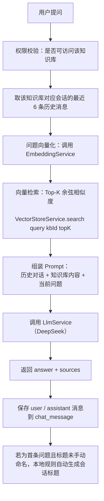

# RAG 核心流程

> 本文档基于当前代码实际实现整理。

## 1. 文档入库流程（Ingestion）

```mermaid
flowchart TD
    A[用户上传 PDF] --> B[权限校验：是否可编辑该知识库]
    B -->|否| B1[返回无权编辑]
    B -->|是| C[保存文件到 data/documents（UUID 文件名）]
    C --> D[创建 document 记录，状态 UPLOADED]
    D --> E[PdfDocumentParser 按页提取文本]
    E --> F[状态更新为 PARSING]
    F --> G[SimpleTextSplitter 字符分块 chunkSize=1000 overlap=200]
    G --> H[保存 document_chunk 到 MySQL]
    H --> I[状态更新为 INDEXING]
    I --> J[事务提交后异步执行 VectorIndexingService]
    J --> K[逐批调用 EmbeddingService（批大小 30）]
    K --> L[写入 data/vector-store/{kbId}.json]
    L --> M[状态更新为 COMPLETED]
    K -->|异常| N[清理脏向量数据，状态更新为 FAILED 并记录 error_message]
```

说明：

- 上传接口 `POST /api/v1/knowledge-bases/{kbId}/documents` 会**同步**完成「保存文件 → 解析 → 分块 → Chunk 入库」，Embedding 与向量写入通过 `AfterCommitExecutor` 在**事务提交后异步**执行，避免大文档导致 HTTP 超时。
- 分块以字符数为单位，`chunk-size=1000`、`overlap=200`（见 `application.yml`）。
- Embedding 调用按批处理，每批 30 个 Chunk（见 `KnowledgeBaseIndexService.EMBEDDING_BATCH_SIZE`）。

## 2. 问答流程（Query / RAG）



说明：

- 检索结果 `sources` 包含 `chunkId`、`documentId`、`knowledgeBaseId`、`chunkIndex`、`pageNumber`、`score`、`content`。
- 向量检索按 `knowledgeBaseId` 严格隔离：只读取 `data/vector-store/{kbId}.json`，不会跨知识库召回。
- 单次问答接口为 `POST /api/v1/rag/chat`；多轮问答为 `POST /api/v1/conversations/{id}/chat`，两者最终都复用 `RetrievalService` 与 `LlmService`。
- 会话历史只取最近 6 条，避免 Prompt 无限增长。
